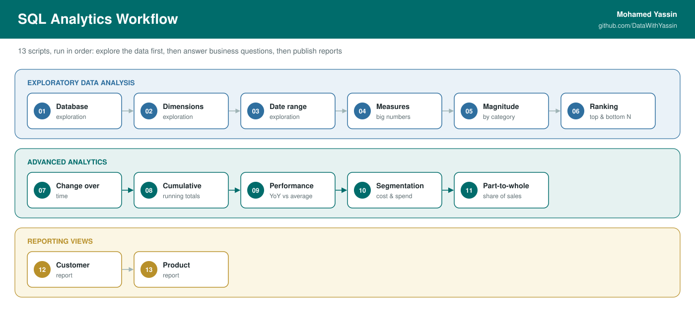

# SQL Data Analytics | Sales, Customers & Products

Exploratory and advanced SQL analysis on a retail sales dataset, ending in two reporting views (customers and products) with the KPIs a business team would use every week.

---

## Business questions

- How are sales changing month over month and year over year?
- Which products and categories drive most of the revenue, and which ones underperform?
- Who are the VIP, regular, and new customers, and how much is each segment worth?
- What share of total sales does each category contribute?
- How recently has each customer bought, and what is their average order value?

---

## Dataset

A star schema from my [SQL Data Warehouse project](https://github.com/DataWithYassin/SQL.Data.warehouse.Project):

| Table | Description |
|---|---|
| `gold.fact_sales` | Sales transactions: order number, dates, sales amount, quantity, price |
| `gold.dim_customers` | Customer details: name, country, gender, birthdate |
| `gold.dim_products` | Product details: category, subcategory, cost, product line |

CSV files and a SQL Server backup are in [`datasets/`](datasets/).

---

## Analysis workflow

| # | Script | What it does | Techniques |
|---|---|---|---|
| 01 | Database exploration | Lists tables and columns | `INFORMATION_SCHEMA` |
| 02 | Dimensions exploration | Explores countries, categories, subcategories | `DISTINCT` |
| 03 | Date range exploration | Finds first and last order dates, customer age range | `MIN`, `MAX`, `DATEDIFF` |
| 04 | Measures exploration | Total sales, quantity, orders, customers, average price | Aggregations, `UNION ALL` |
| 05 | Magnitude analysis | Sales and customers by country, category, gender | `GROUP BY` |
| 06 | Ranking analysis | Top and bottom products and customers | `RANK`, `TOP N` |
| 07 | Change over time | Monthly and yearly sales trends | `DATETRUNC`, `FORMAT` |
| 08 | Cumulative analysis | Running total and moving average of sales | Window functions |
| 09 | Performance analysis | Year-over-year change and comparison to product average | `LAG`, `AVG() OVER` |
| 10 | Data segmentation | Products by cost range, customers by spending behaviour | `CASE`, CTEs |
| 11 | Part-to-whole | Each category's share of total sales | `SUM() OVER` |
| 12 | Customer report | Reporting view with customer KPIs | CTEs, view |
| 13 | Product report | Reporting view with product KPIs | CTEs, view |

---

## Final reports

### `gold.report_customers`
- Segments: **VIP, Regular, New**, plus age groups
- Metrics: total orders, total sales, total quantity, total products, lifespan (months)
- KPIs: **recency**, **average order value**, **average monthly spend**

### `gold.report_products`
- Segments: **High Performer, Mid-Range, Low Performer** by revenue
- Metrics: total orders, total sales, total quantity, unique customers, lifespan (months)
- KPIs: **recency**, **average order revenue**, **average monthly revenue**

These views are ready to connect to Power BI or Excel for dashboards.

---

## How to run

1. Run `scripts/00_init_database.sql` (or restore `datasets/DataWarehouseAnalytics.bak`)
2. Run scripts `01` to `13` in order

---

## Acknowledgements

Built while following the SQL Data Analytics course by [Data With Baraa](https://github.com/DataWithBaraa). Dataset provided by the course.

---

**Mohamed Yassin** | Data Analyst | [LinkedIn](https://www.linkedin.com/in/mohamedelesseily/) | [GitHub](https://github.com/DataWithYassin)
